# Schmetterlingswiese 3.2.0 – Look nach „Crimson Loong“ (20.11.2026, rog17)

Vorbild: <https://github.com/ChetasLua/crimson-loong> (three.js, alles prozedural). Übernommen und an die Wiese
angepasst wurden die Bausteine, die auf dem Handy bezahlbar sind. Drachen, Tempel, Feuer und Blitze wurden nicht übernommen.
Den alten Look gibt es weiter unter `?look=alt`. Spielablauf, Level, Tiere, Garderobe, Stunts und Spielstände sind unverändert.

## Was übernommen wurde

| Vorbild | Schmetterlingswiese | Datei |
|---|---|---|
| 05_glsl `clFog` (zwei Medien) | Luftperspektive: Wiesendunst liegt tief und nimmt die Sonnenfarbe an, die blaue Luft stapelt sich mit der Entfernung. Die fernen Hügel werden blauer und heller. | `js/engine/gfx.js` `applyFog`, `FAR_F` |
| 80_post Grading | ACES-Fit, Split-Tone (Schatten bläulich, Licht bernstein), S-Kurve, weiche Vignette, Belichtung `?expo=` | `gfx.js` `COMP_F` |
| 20_sky Cumulus | Cumulus-Schicht im Himmels-Shader (fbm statt 3D-Rauschtextur). Licht kommt aus der Dichte-Differenz zur Sonne: Silberrand, abends warm von unten. Die Menge ist je Welt einstellbar (Mittag: wenig). | `gfx.js` `SKY_F`, `game/worlds.js` |
| 66_wake | Wake-Spur: An den letzten 6 Orten des Falters biegen sich Halme und Blüten weg und federn gedämpft nach (1,8 s). | `gfx.js` `wakeBend`, `main.js` `wake()`, `world/deko.js` |
| v2-08-dusk | Rosa-oranges Abendband über dem Horizont | `SKY_F` |
| (Licht/Vegetation) | Wiesengrün wärmer (gelbgrün), Halmfuß im Schatten, Boden zwischen den Halmen dunkler mit feiner Fleckung, ziehende Schattenfelder | `gfx.js` `wiesenTon` |

Nach der Kritik entfernt bzw. entschärft: die Lichtsäulen-Körper mit harten Kanten (aus), der Aufwind-Schlauch mit weicher
Silhouette statt harter Kante (bleibt sichtbar, weil er fürs Spiel wichtig ist), halb so viele Schirmchen.

Nicht übernommen: 40_flora (Bäume/Sträucher/Gras), 68_water, 72_air (Vögel, Nebelschwaden), AO und Sonnenstrahlen-Pass
aus 80_post. Diese Bausteine hängen im Vorbild an Schattenkarte, 3D-Rauschtextur und Tiefenpuffer-Pässen. Das passte
nicht ins Zeitfenster und ist auf dem iPhone riskant. **Offen** für einen Folgelauf.

## Bilder vorher/nachher (Stufe Mittel = Handy-Standard, Pixel-7-Emulation)

| Pose | vorher (3.1) | nachher (3.2) |
|---|---|---|
| Start | 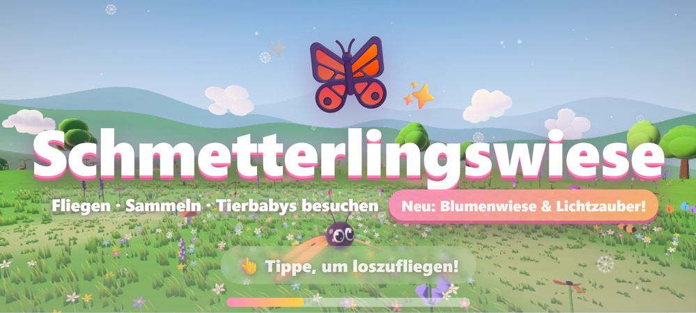 | 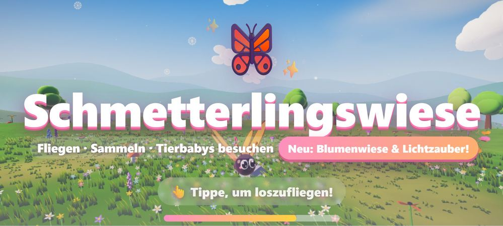 |
| Wiese | 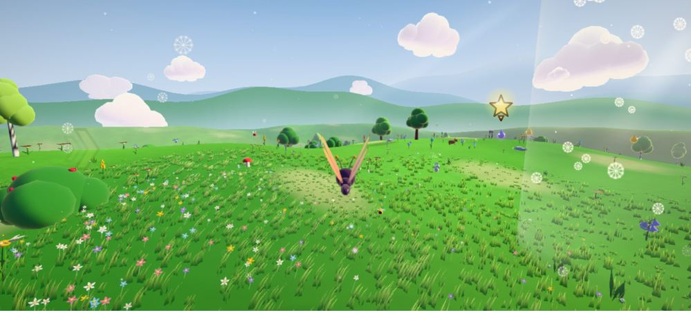 | 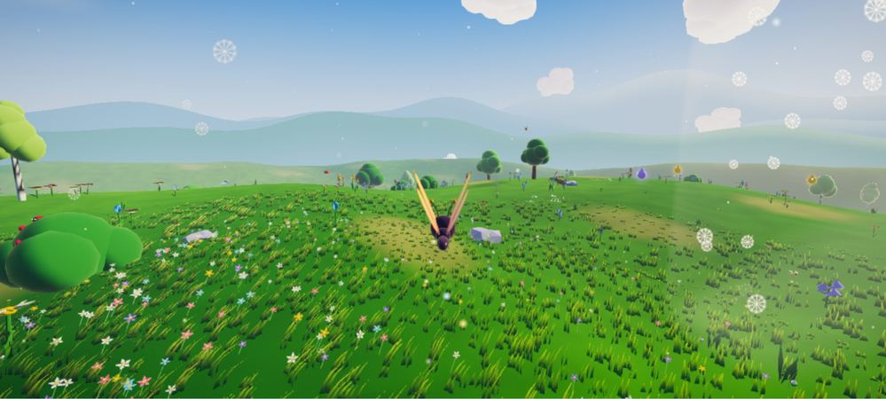 |
| Tiefflug | 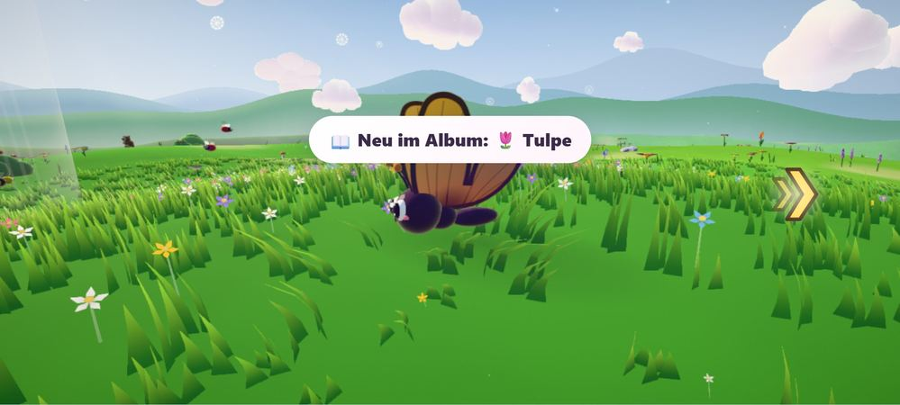 | 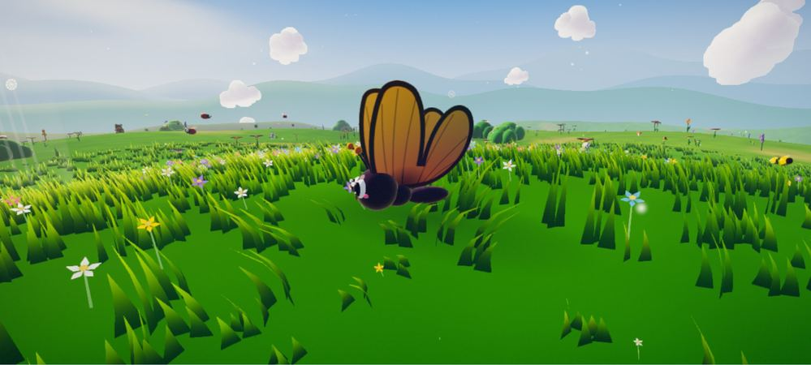 |
| Sonnenblume | 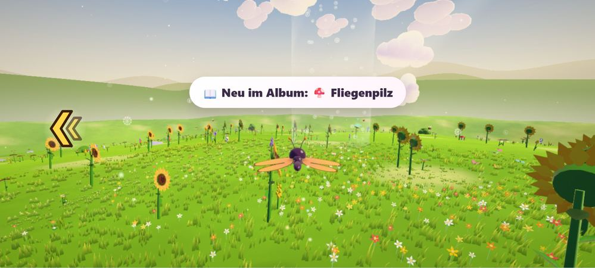 | 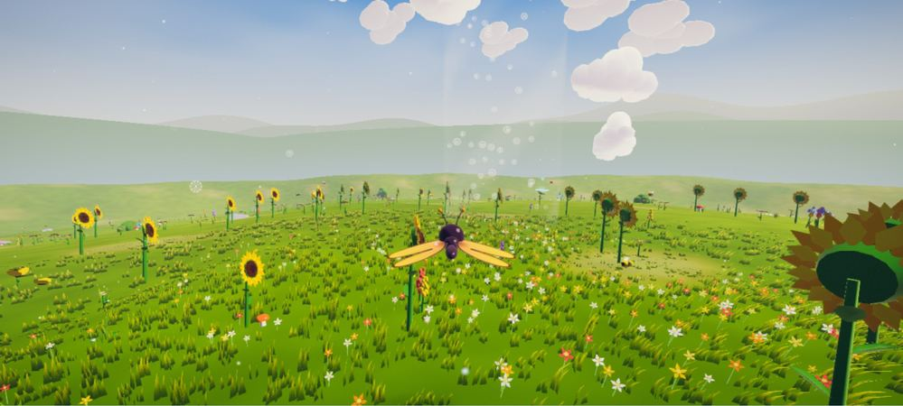 |
| Gegenlicht | 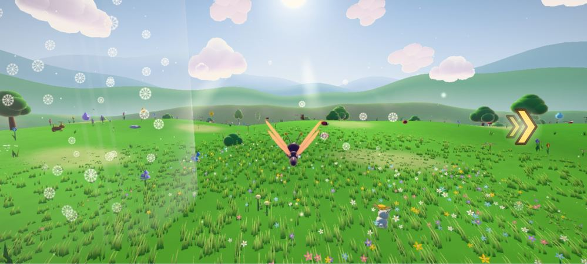 | 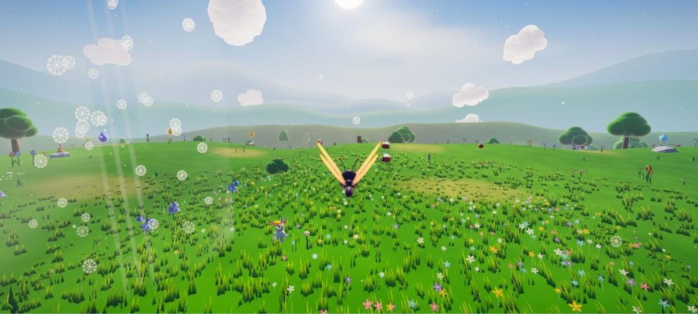 |
| Abend | 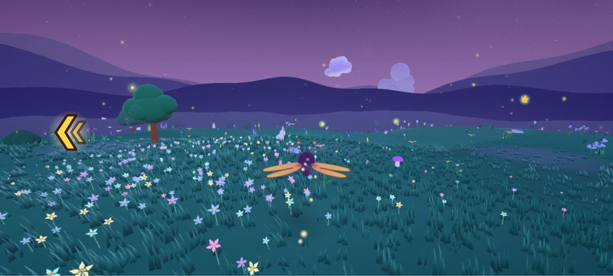 | 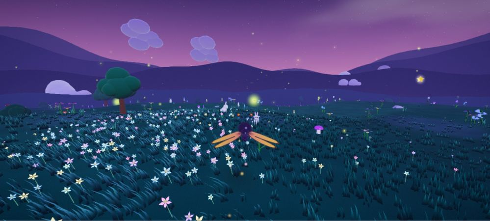 |
| Hochformat | 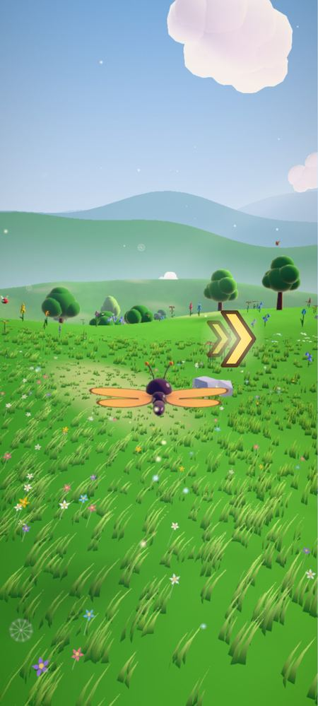 | 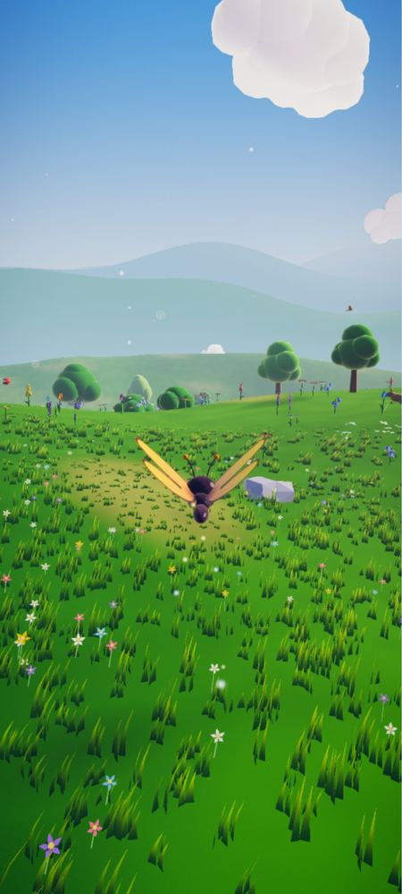 |

Die Posen erzeugt `py tests/look_shots.py <label> [query]`. Hinweis: Die Wolken-Meshes und Tiere bewegen sich,
die Bilder sind deshalb nicht pixelgleich.

## Blinde Kritik (3 Runden, je ein neuer Subagent, nur Bilder + Vorbild-Stills)

1. **Runde 1:** „nur knapp schöner“. Schwer: harte Lichtwände (Aufwind-Schlauch, Lichtsäulen). Mittel: zu viele
   Schirmchen, Neon-Grün, verwaschener Mittag, flacher Abend. → Lichtsäulen aus, Schlauch weich, Schirmchen halbiert,
   Wiesenton, Abendband.
2. **Runde 2:** „ja, knapp“. Schwer: flacher grüner Vordergrund im Tiefflug. Mittel: grauer Mittagshimmel, flache Hügel.
   → Halmfuß-Schatten, dunklerer Boden mit Fleckung, Hügel-Luftperspektive, blauerer Tageshorizont.
3. **Runde 3:** Gesamturteil **ja, schöner**. Start, Wiese, Gegenlicht, Abend und Hochformat sind besser, der Tiefflug ist
   gleich bis besser, nur die Sonnenblume ist schlechter (grauer Himmel). → Ursache gefunden: Das Cumulus-Rauschen
   verschmierte flach am Horizont zu einem Grauschleier. Wolken erst ab etwas Höhe, hellere Basis, wenig Cumulus am
   Mittag. Das Endbild zeigt wieder blauen Himmel (nach Runde 3 nur selbst geprüft, keine vierte Runde laut Vorgabe).
   Weiter offen (mittel): Wolken-Meshes hängen teils vor der Hügelkante, die Hügel haben keine Struktur, gelber
   Landeplatz-Fleck unter der Figur, kalter Boden am Abend.

## Bildrate (perf_gate, A/B im Wechsel, 3 Runden, Median; Pixel-7-Profil, CPU ×4 gedrosselt, DPR 2,6, hoch)

| Szene | alt p50 / p95 (ms) | neu p50 / p95 (ms) | Δ p95 |
|---|---|---|---|
| wiese_mittel | 14,0 / 30,5 | 13,5 / 29,6 | −3 % |
| wiese_hoch | 13,9 / 31,1 | 13,6 / 31,6 | +2 % |
| mission_abend_mittel | 13,3 / 26,9 | 11,7 / 27,6 | +3 % |

Gemessen wurde dreimal im Wechsel und je Variante der Median genommen, Ausreißer fallen so heraus (am rog spielen
manchmal die Kinder). Ergebnis: Der neue Look kostet nichts Messbares, alle Werte liegen im Rauschen (±3 %).
test_frametimes: q0/q1/q2 jeweils p50 16,7 ms (60 Hz, gedeckelt). Rohdaten: `tests/perf/2026-11-20_v32ab.json`.
Der Shader-Mehraufwand ist klein: Himmel 2× fbm mit 4 Oktaven je Himmelspixel, Dunst ein exp mehr je Pixel, Wake
6 Abstände je Halm im Vertex-Shader, Grading ein paar ALU-Takte im bestehenden Endbild-Pass. Es kommt kein neuer
Render-Pass und kein neuer Draw-Call dazu.

**Adaptive Qualität / Handy-Stufe:** Das Spiel hat seit 2.9 schon einen Autopiloten, der mehr kann als 90_main des
Vorbilds: Er misst die echte Arbeit je Bild (GPU-Zeit, wo vorhanden), senkt die Renderskala stufenlos von 100 auf 60 %,
halbiert dann die Deko und senkt danach die Stufe. Er merkt sich das Gerät. Handys starten auf „Mittel“ (eigene
Handy-Stufe), Stufe Niedrig ohne Post bleibt der Rückfall. Daran wurde nichts geändert. Der neue Look gilt auf Mittel und
Hoch über das Grading, Himmel, Dunst und Wake gelten auf allen Stufen.

## Größe

| Ordner (im Git) | vorher | nachher | Bemerkung |
|---|---|---|---|
| js | 0,79 MB | 0,79 MB | +≈ 6 KB Shader-Code |
| lib (three.js r186) | 0,77 MB | 0,77 MB | bleibt als Datei: Bibliothek, MIT |
| icons | 0,18 MB | 0,18 MB | bleiben: PWA-/Homescreen-Icons müssen PNG-Dateien sein |
| css + html + manifest | 0,05 MB | 0,05 MB | |
| **Spiel gesamt** | **1,98 MB** | **1,99 MB** | |
| tests (Prüfbilder früherer Berichte) | 40,6 MB | 41,5 MB | v32-Vergleichsbilder +0,9 MB |

Die „~42 MB“ sind fast ganz Prüf-Screenshots in `tests/shots` (39,7 MB). Das Spiel selbst lädt keine Bild-, Modell-
oder Tondatei: Modelle, Texturen, Musik und Klänge entstehen schon seit 2.x im Code. Ersetzbar war also nichts. Der
neue Look kommt ebenfalls ohne Dateien aus.

## Tests

- Node: 68/68 grün. `test_r186` lief unter Windows nicht (Pfad aus `URL.pathname`) und ist jetzt mit `fileURLToPath` repariert.
- Browser grün: v31_flatter, v31_ringe, v31_landen, v31_rolle, levels, v28_deko, ui, magnet_stuck, schmuck, pwa_input,
  leaks, anatomy, frametimes, v24_tiere.
- Am rog im Zeitlimit **nicht** durchgelaufen: celebrate, v27_missionen, glitter_bounds, stuntshow. celebrate hängt auch
  auf dem alten Stand 3.1 genauso (Umgebung, kein Fehler von 3.2). Die übrigen Suiten (v30, v26, v25, v22, Audio, perf)
  wurden aus Zeitgründen nicht gefahren. Sie berühren keine geänderte Logik.
- `perf_gate.py` hat jetzt eine Plattform-Weiche für Windows (D3D11), am Mac bleibt es unverändert.
